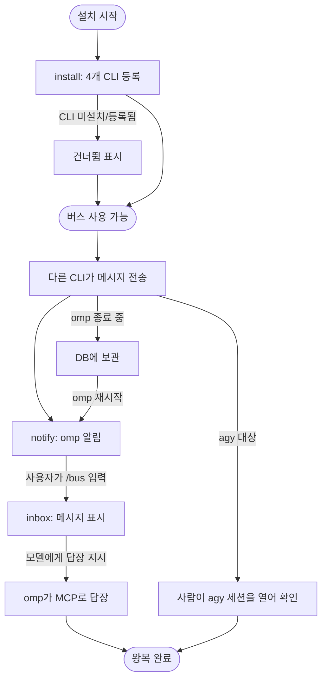

# agents-bus — UX flow

[← Hub](README.md) · Prev: [2. Feature spec](02-spec.md) · Next: [5. Design system (DESIGN.md)](../DESIGN.md)

Created: 2026-11-18

<!-- wf:flow
status: done
-->

> Basis: [feature spec](02-spec.md). Done when: every Must feature appears in the flow and the user has confirmed → `status: done`

## At a glance

- 화면은 터미널 텍스트 3곳: 설치 출력(install), omp 알림(notify), omp `/bus` 메시지 표시(inbox). 나머지 CLI는 MCP 도구 호출로 버스를 쓴다.
- 핵심 경로: 설치 한 줄 → 4개 CLI 등록 → 다른 CLI가 전송 → omp 알림 → `/bus`로 읽기 → 모델에게 답장 지시.
- agy는 사람이 연 대화형 세션에서만 버스를 호출한다. 알림 경로가 없다.

## Screen list

These become the stage 6 wireframe file names. A slug is lowercase letters, digits, and `-`.

| slug | Screen name | Related feature |
| --- | --- | --- |
| install | 설치 출력 (`node scripts/install.mjs`) | [F-01](02-spec.md#f-01), [F-06](02-spec.md#f-06) |
| notify | omp 새 메시지 알림 | [F-03](02-spec.md#f-03) |
| inbox | omp `/bus` 메시지 표시 | [F-02](02-spec.md#f-02), [F-03](02-spec.md#f-03), [F-05](02-spec.md#f-05) |

F-04(약관 가드)는 `checks` 검사이므로 화면이 없다. F-07은 Could라 흐름에서 제외한다.

## Overall flow

## Core task paths

| Feature | Start screen | Path | Exit/exception branches |
| --- | --- | --- | --- |
| [F-01](02-spec.md#f-01) | [install](06-wireframe/install.html) | install → 버스 사용 가능 | `uvx` 없음 → 중단·안내 / CLI 미설치 → 건너뜀 |
| [F-02](02-spec.md#f-02) | [inbox](06-wireframe/inbox.html) | 전송 → notify → inbox → 답장 | 피어 이름 중복 → 재접속 |
| [F-03](02-spec.md#f-03) | [notify](06-wireframe/notify.html) | 전송 → notify → `/bus` → inbox | DB 없음 → 조용히 대기 / 확장 로드 실패 → omp 정상 동작 |
