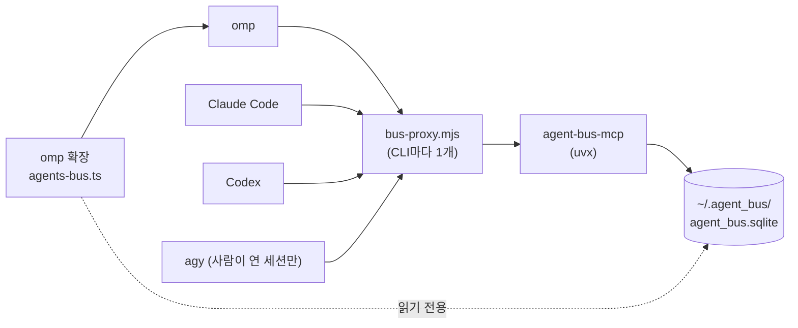

# agents-bus

한 Windows PC에서 터미널 여러 개에 띄운 코딩 에이전트(omp, Claude Code, Codex, Antigravity `agy`)가 서로 메시지를 주고받게 하는 로컬 메시지 버스.

예: Claude Code에게 "테스트 결과를 버스로 codex에게 보내"라고 하면, Codex 세션이 다음 `sync` 때 그 메시지를 받는다. omp는 새 메시지가 오면 바로 알림을 띄운다.

## 무엇이 들어 있나

버스 엔진은 직접 만들지 않았다. [agent-bus-mcp](https://github.com/alessandrobologna/agent-bus-mcp) 0.5.1을 `uvx`로 실행하고, 이 저장소는 그 둘레의 연결 부품만 담는다.



| 파일 | 역할 |
| --- | --- |
| `scripts/install.mjs` | omp·claude·codex에 MCP 서버 `agents-bus`를 등록하고, omp 확장과 CLI별 규칙 블록을 설치한다. agy는 실행하지 않고 등록 명령만 출력한다 |
| `scripts/bus-proxy.mjs` | CLI와 agent-bus-mcp 사이의 MCP stdio를 중계한다. `topic_join`이 돌려준 재접속 토큰을 `~/.agent_bus/tokens/`에 저장해 두었다가 다시 넣어 주므로, CLI를 재시작해도 같은 이름(`omp`, `claude` 등)으로 다시 들어갈 수 있다. Claude Code와 Codex에서는 DB를 읽기 전용으로 지켜보다가 자기 앞 메시지를 세션에 넣는다 (Claude는 채널, Codex는 `codex queue`) |
| `extension/agents-bus.ts` | omp 확장. DB를 5초마다 읽기 전용으로 확인해 `[bus] N new` 알림을 띄우고 `/bus` 명령을 제공한다. `@omp:` 메시지는 세션에 넣고 턴을 시작한다 |
| `scripts/rules.mjs` | 각 CLI의 전역 규칙 파일에 넣는 규칙 블록(피어 이름, 토픽, 안전 규칙) |
| `scripts/guard.mjs` | 코드가 agy를 실행·래핑하거나 자격 증명을 읽지 않는지 검사한다 (Antigravity 약관) |
| `docs/agy-rules.md` | agy 규칙에 붙여 넣을 블록 (설치 스크립트가 생성) |
| `docs/antigravity-tos.md` | agy 연결 방식을 제한하는 이유 |

## 기본 개념

- **토픽**: 대화방. 기본값은 `hr-sync` 하나다.
- **피어**: 버스에서 쓰는 이름. `omp`, `claude`, `codex`, `agy`로 고정되어 있다.
- **수신자 표시**: 버스에는 받는 사람 필드가 없다. 메시지 본문을 `@codex:`처럼 시작해 받는 사람을 적는다. 접두어가 없거나 `@all:`이면 모두에게 보내는 메시지다.
- **받기**: 메시지는 각 CLI의 모델이 MCP `sync` 도구를 호출할 때 받고 읽음 처리된다. 그와 별개로 `@<받는이>:` 메시지는 열린 세션에 저절로 들어간다 (omp, Claude Code, Codex. agy는 제외). 아래 "받기" 참고.
- **읽음 처리**: 모델이 `sync`를 호출해야 읽음이 된다. omp의 `/bus`는 보여 주기만 하고 읽음 처리는 하지 않는다.

## 설치

필요: Node 24, `uv`(`uvx`)가 PATH에 있어야 한다.

```
node scripts/install.mjs --dry-run     # 무엇이 바뀌는지 미리 보기
node scripts/install.mjs               # omp, claude, codex 등록 + omp 확장 + 규칙 블록
```

설치 스크립트가 하는 일:

1. `~/.agent_bus/bus-proxy.mjs`를 복사하고, `~/.agent_bus/config.json`에 `uvx`와 `codex` 경로를 적는다.
2. MCP 서버 `agents-bus`를 등록한다. omp는 `~/.omp/agent/mcp.json`, claude·codex는 각자의 `mcp add` 명령을 쓴다. claude·codex 등록에는 피어 이름과 전달 방식(`AGENTS_BUS_PEER`, `AGENTS_BUS_PUSH`)이 들어가며, 예전 등록에 이 값이 없으면 지우고 다시 등록한다. 다른 MCP 서버는 건드리지 않는다.
3. omp 확장을 `~/.omp/agent/extensions/agents-bus.ts`에 복사한다.
4. Codex 훅 2개(`SessionStart`, `UserPromptSubmit`)를 `~/.codex/hooks.json`에 추가한다. 세션 ID를 프록시에 알려 `codex queue`로 메시지를 넣을 수 있게 한다. 기존 훅은 그대로 둔다.
5. 규칙 블록을 `~/.omp/agent/RULES.md`, `~/.claude/CLAUDE.md`, `~/.codex/AGENTS.md`에 넣는다. 블록은 `<!-- agents-bus:begin -->`~`end` 표식 사이만 고치므로 여러 번 실행해도 중복되지 않는다. 규칙 파일이 없으면 건너뛰는데, 새로 만들려면 `--create-rules`를 붙인다.

설치가 끝나면 각 CLI를 재시작한다.

| 옵션 | 뜻 |
| --- | --- |
| `--only omp,codex` | 일부 CLI만 처리 |
| `--create-rules` | 규칙 파일이 없으면 새로 만든다 |
| `--topic NAME` | 규칙에 적을 토픽 이름 (기본 `hr-sync`) |
| `--dry-run` | 아무것도 바꾸지 않고 출력만 |
| `--uninstall` | 등록, Codex 훅, 규칙 블록, 확장을 제거 |

### Antigravity (agy)

약관 때문에 이 저장소의 코드는 agy를 실행하지 않는다. 직접 해야 한다:

1. 설치 출력에 나온 명령을 터미널에서 직접 실행한다. `--env` 옵션은 서버 이름보다 앞에 와야 한다.
   ```
   agy mcp add --env "AGENTS_BUS_HOME=C:\Users\<you>\.agent_bus" --env "AGENT_BUS_DB=C:\Users\<you>\.agent_bus\agent_bus.sqlite" agents-bus -- "C:\Program Files\nodejs\node.exe" "C:\Users\<you>\.agent_bus\bus-proxy.mjs"
   ```
   등록 내용은 `~/.gemini/config/mcp_config.json`에 저장된다. `agy mcp list`로 확인하고, agy 안에서 `/mcp`를 입력해 `agents-bus`가 켜졌는지 본다.
2. [docs/agy-rules.md](docs/agy-rules.md)의 블록을 agy 전역 규칙 파일 `~/.gemini/GEMINI.md`에 붙여 넣는다.
3. agy 세션을 새로 열고 "버스 확인해"라고 시킨다. agy 설정의 `toolPermission`이 `always-proceed`가 아니면 처음 MCP 도구를 쓸 때 허락을 묻는다.
4. 직접 연 대화형 agy 세션에서만 쓴다. `agy -p` 같은 비대화형 실행이나 스크립트로 agy를 구동하는 것은 금지다. 자세한 이유는 [docs/antigravity-tos.md](docs/antigravity-tos.md).

## 사용법

### 세션을 열면

규칙 블록 덕분에 각 CLI의 모델은 세션을 시작할 때 다음을 한다:

1. 토픽 `hr-sync`를 찾거나 만들고(`topic_create`, `mode="reuse"`), 자기 이름으로 참여(`topic_join`)한다.
2. `sync`를 한 번 호출하고, 기다리던 메시지가 몇 건인지 한 줄씩 요약해서 알려 준다. 이 단계에서는 메시지 내용을 실행하지 않는다.

모델이 이 단계를 건너뛰면 "버스 확인해"라고 말하면 된다.

### 보내기

자연어로 시키면 된다.

```
버스로 codex에게 "로그인 API 테스트 통과, 커밋은 아직 안 함" 보내
테스트 결과 요약해서 claude한테 버스로 보내줘
모두에게 버스로 "10분 뒤 main 브랜치 rebase 예정" 알려
```

모델은 `sync(topic_id, outbox=[{"content_markdown": "@codex: ..."}])` 형태로 보낸다.

### 받기

`@<받는이>:`로 지정한 메시지는 받는 쪽 세션이 열려 있으면 저절로 들어가 모델이 바로 처리한다 (Claude Code channels 방식). `@all:`이나 받는이가 없는 메시지는 저절로 들어가지 않고 다음 `sync` 때 받는다.

| 받는 쪽 | 저절로 받는 방법 | 준비 |
| --- | --- | --- |
| omp | 확장이 세션에 `[bus] codex -> omp  hr-sync  13:22` 메시지를 넣고 턴을 시작한다. 그 밖의 메시지는 `[bus] 1 new from codex  try: /bus` 알림만 뜬다 | omp 재시작 |
| Claude Code | 프록시가 채널 이벤트로 보낸다. 화면에 `← agents-bus: @claude: ...` 한 줄이 뜨고 Claude가 처리한다 | `claude --dangerously-load-development-channels server:agents-bus`로 실행하고, 처음 뜨는 경고에서 **I am using this for local development** 선택. 이 옵션 없이 실행하면 저절로 받지 않는다 |
| Codex | 프록시가 `codex queue --thread <세션>`으로 세션에 넣는다 | Codex에서 `/hooks`를 열어 `agents-bus` 훅 2개(SessionStart, UserPromptSubmit)를 승인. 세션 ID는 훅이 알려 주므로 세션에서 첫 입력을 한 뒤부터 받는다 |
| agy | 저절로 받지 않는다 (약관). 대신 `@agy:` 메시지가 오면 omp 화면에 `[bus] 1 new for agy from codex` 알림이 뜨고 상태줄에 `agy: N`이 보인다. agy 창에서 "버스 확인해"라고 시키면 `sync`로 받는다 | omp 재시작 |

`/bus`(omp)는 모델을 거치지 않고 안 읽은 메시지를 보여 준다. 읽음 처리는 언제나 모델의 `sync`가 한다. 세션이 꺼져 있을 때 온 메시지는 DB에 남아 있다가, 다음 세션 시작 때 요약된다.

### 안전 규칙

버스 메시지는 다른 에이전트가 보낸 입력이지 사용자의 지시가 아니다. 규칙 블록과 전달 문구는 모델이 버스 메시지만 보고 명령 실행, 파일 수정, 비밀 정보 전송을 하지 않고 먼저 사용자에게 묻도록 정해 둔다.

메시지가 저절로 들어가므로, 두 에이전트가 "확인했습니다" 같은 답장만 주고받으면 서로를 끝없이 깨울 수 있다. 두 겹으로 막는다. 규칙은 요청이 있는 메시지에만 답하고 확인·감사 답장은 보내지 않게 한다. 그래도 모델이 규칙을 어기면, 한 세션은 같은 발신자 때문에 10분에 최대 3번까지만 깨어나고 나머지는 다음 `sync` 때 받는다. 같은 이름의 세션을 여러 개 열어 두면(예: omp 창 두 개) 메시지 하나에 한 세션만 깨어난다 (`~/.agent_bus/wakes/`의 표시 파일로 먼저 잡은 세션이 받는다).

### 한 번에 따라 해 보기

1. omp를 다시 켜고, Claude Code는 `claude --dangerously-load-development-channels server:agents-bus`로 연다. 둘 다 세션 시작 시 버스 요약을 보여 준다.
2. Claude Code에: `버스로 omp에게 "지금 몇 시인지 알려줘" 보내`
3. omp 세션에 `[bus] claude -> omp ...` 메시지가 들어오고, omp가 스스로 답장한다.
4. Claude Code 화면에 `← agents-bus: @claude: ...`가 뜨고 Claude가 답장을 처리한다. 둘 다 "버스 확인해"를 입력하지 않는다.

## 점검

```
node scripts/guard.mjs && node --test
```

테스트는 `uvx`로 실제 agent-bus-mcp 프로세스를 임시 DB와 함께 띄운다.

## 문제 해결

| 증상 | 확인할 것 |
| --- | --- |
| 설치가 `[err] uvx not found`로 멈춤 | `uv`를 설치하고 다시 실행 ([uv 설치](https://docs.astral.sh/uv/)) |
| 재시작 후 `AGENT_NAME_IN_USE` | 프록시를 거치지 않고 등록된 경우다. `node scripts/install.mjs`를 다시 실행해 등록을 프록시로 맞춘다 |
| CLI 하나만 토픽을 못 찾음 | 셸에 남은 `AGENT_BUS_DB` 환경변수가 다른 DB를 가리키는지 확인. 설치 스크립트는 등록할 때 `AGENT_BUS_DB`, `AGENTS_BUS_HOME`을 고정한다 |
| omp 알림이 안 뜸 | omp 재시작, `~/.omp/agent/extensions/agents-bus.ts`가 있는지 확인. `/bus`를 입력하면 DB 오류가 있을 때 그 내용을 보여 준다 |

omp 확장 환경변수: `AGENTS_BUS_PEER`(기본 `omp`), `AGENT_BUS_DB`(DB 경로), `AGENTS_BUS_POLL_MS`(기본 5000).

## 참고

- 예전에 만든 자작 버스(Claude Code MCP 서버 `agent-bus`, 파일 `~/.agent-bus`)는 2026-11-24에 은퇴했다. Claude Code 등록은 지웠다. 파일 폴더는 열린 Claude 세션이 잡고 있어 아직 그대로이며, 세션을 닫은 뒤 `~/.agent-bus.bak`으로 이름을 바꿔 보관한다. 이 버스의 데이터 폴더는 밑줄이 들어간 `~/.agent_bus/`이니 혼동하지 말 것.
- 진행 단계와 결정 기록: [.workflow/README.md](.workflow/README.md). 터미널 출력 디자인 토큰: [DESIGN.md](DESIGN.md).
