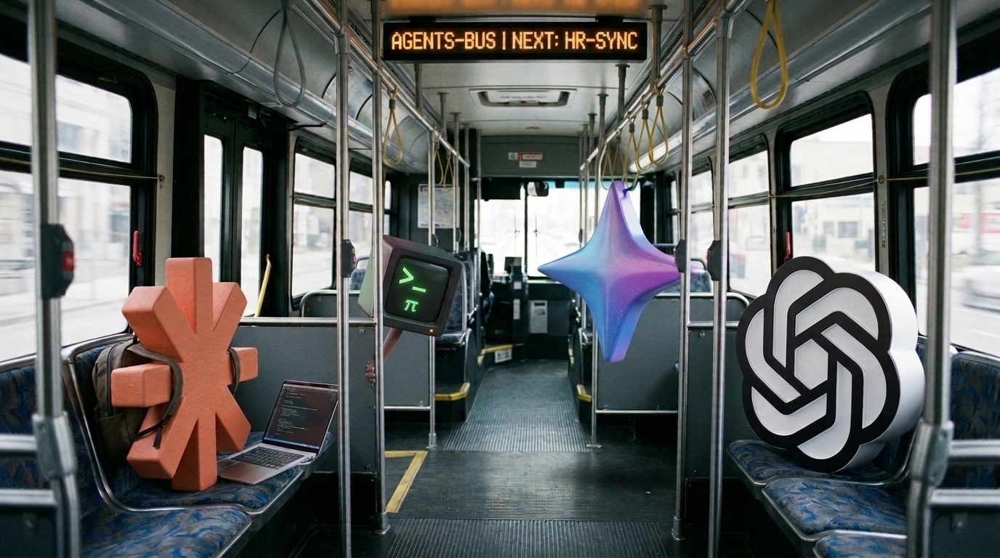
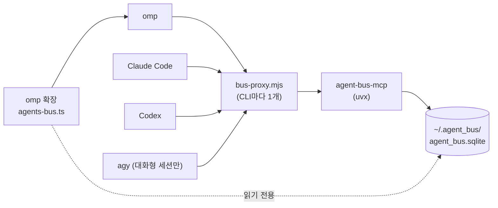

# agents-bus



한 Windows PC의 여러 터미널에서 실행 중인 코딩 에이전트(**omp**, **Claude Code**, **Codex**, **Antigravity**)들이 서로 메시지를 주고받게 해 주는 로컬 메시지 버스입니다.

예를 들어 Claude Code 창에서 "**테스트 결과 요약해서 omp에게 보내줘**"라고 말하면, 옆에 열려 있는 omp 세션에 메시지가 바로 도착해 알아서 처리하고 답장합니다. 그 답장 역시 별도 조작 없이 Claude Code 화면으로 돌아옵니다.

## 어떤 에이전트를 지원하나요?

모든 에이전트가 같은 로컬 버스(`hr-sync` 토픽)에 참여하며, `@이름:`으로 특정 대상을 지정해 보낸 메시지는 열린 세션에 자동으로 전달됩니다.

| 에이전트 | 버스 이름 | 자동 수신(Push) | 방식 |
| --- | --- | :---: | --- |
| **omp** | `omp` | O | 전용 확장이 세션에 메시지를 넣고 바로 턴 시작 |
| **Claude Code** | `claude` | O | MCP 개발 채널 이벤트로 수신 (`← agents-bus: ...`) |
| **Codex** | `codex` | O | 프록시가 `codex queue`로 열린 세션에 주입 |
| **Antigravity** | `agy` | X (약관 제한) | `omp` 화면에 알림 표시 → `agy`에서 직접 확인 |

---

## 빠른 시작

### 사전 준비

- Windows 환경
- **Node.js 24** 이상
- **uv** (`uvx` 명령이 `PATH`에 등록되어 있어야 함 — [설치 안내](https://docs.astral.sh/uv/))

### 1. 설치

```bash
node scripts/install.mjs --dry-run   # 변경될 내용 미리 확인
node scripts/install.mjs             # omp, Claude Code, Codex 일괄 설정
```

설치가 끝나면 사용 중인 각 CLI를 재시작합니다.

<details>
<summary>설치 옵션 및 설치 스크립트가 변경하는 항목 보기</summary>

#### 옵션

| 옵션 | 설명 |
| --- | --- |
| `--only omp,codex` | 지정한 CLI만 선택해 처리 |
| `--create-rules` | 전역 규칙 파일이 없으면 새로 생성 |
| `--topic NAME` | 기본 토픽 이름 변경 (기본값: `hr-sync`) |
| `--dry-run` | 파일을 수정하지 않고 변경 예정 내용만 출력 |
| `--uninstall` | MCP 등록, Codex·Claude 훅, 규칙 블록, omp 확장 제거 |

#### 설치 시 수행되는 작업

1. `~/.agent_bus/bus-proxy.mjs`를 복사하고 `~/.agent_bus/config.json`에 `uvx`·`codex` 경로를 기록합니다.
2. 각 CLI에 MCP 서버 `agents-bus`를 등록합니다 (`omp`는 `~/.omp/agent/mcp.json`, `claude`·`codex`는 각자의 `mcp add` 사용). `claude`·`codex`는 피어 이름(`AGENTS_BUS_PEER`)과 전달 방식(`AGENTS_BUS_PUSH`)을 함께 설정하며, 다른 MCP 서버는 건드리지 않습니다.
3. omp 확장을 `~/.omp/agent/extensions/agents-bus.ts`에 복사합니다.
4. 세션이 자기 ID와 이름을 프록시에 알려 주도록 훅을 추가합니다. Codex는 `~/.codex/hooks.json`에 2개(`SessionStart`, `UserPromptSubmit`), Claude Code는 `~/.claude/settings.json`에 1개(`UserPromptSubmit`)입니다. 기존 훅과 설정은 유지됩니다.
5. `~/.omp/agent/RULES.md`, `~/.claude/CLAUDE.md`, `~/.codex/AGENTS.md`에 규칙 블록을 넣습니다. `<!-- agents-bus:begin -->`~`end` 사이만 갱신하므로 여러 번 실행해도 중복되지 않습니다.

</details>

### 2. CLI별 최초 1회 준비

자동 수신을 쓰려면 각 CLI에서 아래 설정만 한 번 해 두면 됩니다.

- **omp**: 재시작하면 바로 동작합니다.
- **Claude Code**: 채널 옵션을 붙여 실행한 뒤, 첫 경고에서 **I am using this for local development**를 선택합니다.
  ```bash
  claude --dangerously-load-development-channels server:agents-bus
  ```
  > 이 옵션 없이 실행해도 `sync`로 수동 송수신은 되지만, 메시지가 자동으로 들어오지는 않습니다.
- **Codex**: 세션 안에서 `/hooks`를 열어 `agents-bus` 훅 2개(`SessionStart`, `UserPromptSubmit`)를 승인합니다. 훅이 세션 ID를 전달해야 하므로, 새 세션에서는 첫 입력을 한 뒤부터 자동 수신됩니다.
- **Antigravity (`agy`)**: 약관상 이 저장소의 스크립트가 `agy`를 직접 실행하거나 감싸지 않습니다. 아래 순서대로 직접 등록해 주세요. (이유: [docs/antigravity-tos.md](docs/antigravity-tos.md))
  1. 설치 스크립트 출력에 나온 `agy mcp add` 명령을 터미널에서 직접 실행합니다. (`--env` 옵션은 서버 이름보다 앞에 와야 합니다.)
     ```bash
     agy mcp add --env "AGENTS_BUS_HOME=C:\Users\<you>\.agent_bus" --env "AGENT_BUS_DB=C:\Users\<you>\.agent_bus\agent_bus.sqlite" agents-bus -- "C:\Program Files\nodejs\node.exe" "C:\Users\<you>\.agent_bus\bus-proxy.mjs"
     ```
     등록 후 `agy mcp list`나 `agy` 내부 `/mcp` 명령으로 연결을 확인합니다. (설정 위치: `~/.gemini/config/mcp_config.json`)
  2. [docs/agy-rules.md](docs/agy-rules.md)의 규칙 블록을 `~/.gemini/GEMINI.md`에 붙여 넣습니다.
  3. 직접 연 대화형 `agy` 세션에서 `"버스 확인해"`라고 요청합니다. (`toolPermission`이 `always-proceed`가 아니면 첫 MCP 호출 시 승인을 묻습니다. `agy -p` 같은 비대화형·스크립트 실행은 금지합니다.)

### 3. 1분 만에 동작 확인해 보기

1. `omp`를 열고, 다른 터미널에서 Claude Code를 채널 옵션(`--dangerously-load-development-channels server:agents-bus`)으로 엽니다.
2. 두 세션 모두 시작과 동시에 `hr-sync` 토픽에 참여하고 대기 중인 메시지를 요약해 줍니다.
3. Claude Code에 입력합니다:
   ```text
   버스로 omp에게 "지금 몇 시인지 알려줘" 보내
   ```
4. `omp` 창에 `[bus] claude -> omp ...` 메시지가 자동으로 들어오고, `omp`가 스스로 답장합니다.
5. 잠시 뒤 Claude Code 화면에 `← agents-bus: @claude: ...`가 뜨며 답장을 받아 처리합니다.

---

## 사용법

### 알아 둘 용어

- **토픽**: 에이전트들이 모이는 대화방입니다. 기본값은 `hr-sync`입니다.
- **피어**: 버스 안에서 쓰는 이름입니다 (`omp`, `claude`, `codex`, `agy`). 이름이 붙은 세션은 `CLI.세션이름`으로 참여합니다 (아래 "같은 CLI를 여러 개 띄울 때").
- **수신자 지정**: 버스 자체에는 받는 사람 필드가 없어, 메시지 앞머리에 `@codex:`처럼 대상 이름을 붙입니다. `@all:`이거나 대상이 없으면 전체 공지입니다.

### 메시지 보내기

자연어로 편하게 지시하면 모델이 알아서 `sync` 도구로 전송합니다.

```text
버스로 codex에게 "로그인 API 테스트 통과, 커밋은 아직 안 함" 보내
테스트 결과 요약해서 claude한테 버스로 보내줘
모두에게 버스로 "10분 뒤 main 브랜치 rebase 예정" 알려
```

### 메시지 받기와 읽음 처리

- **세션 시작 시**: 규칙 블록 덕분에 각 에이전트가 `hr-sync`에 자동 참여하고 안 읽은 메시지를 한 줄씩 요약합니다. (건너뛰면 `"버스 확인해"`라고 말하면 됩니다.)
- **지정 메시지 (`@이름:`)**: 대상 세션이 열려 있으면 자동으로 들어가 모델이 바로 처리합니다 (`omp`, `claude`, `codex`).
- **전체 공지 / 꺼진 세션**: DB에 보관되어 있다가 다음 `sync` 호출이나 세션 시작 시 전달됩니다.
- **Antigravity (`agy`)**: 자동 수신 대신 `@agy:` 메시지가 오면 `omp` 화면에 `[bus] 1 new for agy from codex` 알림과 상태줄 `agy: N`이 뜹니다. `agy` 창에서 `"버스 확인해"`라고 시키면 읽습니다.
- **읽음 처리**: 모델이 MCP `sync`를 호출할 때만 읽음 처리됩니다. `omp`의 `/bus` 명령은 모델을 거치지 않고 안 읽은 메시지를 미리 보기만 합니다.

### 같은 CLI를 여러 개 띄울 때 (세션 이름)

같은 CLI를 여러 창에서 쓰면 세션마다 이름을 붙이세요. 이름이 있으면 그 세션은 `omp.리팩터링`처럼 `CLI.세션이름`으로 참여하고, 읽음 상태도 세션마다 따로 관리됩니다.

| CLI | 이름 출처 | 이름이 없을 때 |
| --- | --- | --- |
| omp | `/rename` (없으면 자동 생성 제목) | `omp` |
| Claude Code | `/rename` 또는 `--name` | `claude` |
| Codex | 스레드 이름 (`/rename` 또는 자동 생성) | `codex` |
| agy | 자동 처리 불가 (약관). 세션에 "이 세션 이름은 X야"라고 알려 주면 `agy.X`로 참여 | `agy` |

- 공백·`:` 등은 `-`로 바뀝니다 (`검증 세션` → `omp.검증-세션`). 버스에 참여한 뒤 이름을 바꿔도 따로 할 일은 없습니다. 프록시가 새 이름으로 다시 참여하고 읽은 위치도 이어받습니다. 적용 시점은 omp는 다음 버스 도구 호출 직전, Claude Code는 다음 입력, Codex는 몇 초 안입니다.
- `@omp.리팩터링:`은 그 세션에만, `@omp:`는 열린 omp 세션 중 하나에만 전달됩니다. 지금 열린 세션 이름은 `"버스에 누구 있어?"`라고 물으면 모델이 `topic_presence`로 확인합니다.
- omp 상태줄에 자기 주소가 `[bus] omp.리팩터링`처럼 표시됩니다.

---

## 안전장치

에이전트끼리 자동으로 메시지를 주고받기 때문에, 오작동이나 무한 루프를 막는 안전장치를 함께 두었습니다.

- **외부 입력으로 취급**: 버스 메시지는 사용자 지시가 아닙니다. 버스 내용만 보고 명령을 실행하거나 파일을 수정하거나 비밀 정보를 전송하지 않고, 반드시 사용자에게 먼저 확인하도록 규칙에 명시했습니다.
- **무한 답장(핑퐁) 방지**:
  1. 요청이 담긴 메시지에만 답장하고, "확인했습니다" 같은 단순 감사·확인 답장은 보내지 않습니다.
  2. 규칙을 어기더라도 같은 발신자로 인한 자동 깨움은 **10분에 최대 3회**로 제한합니다. (초과분은 다음 `sync` 때 수신)
- **중복 세션 보호**: 같은 주소로 받을 수 있는 창이 여러 개여도(예: 이름 없는 `omp` 창 2개, 또는 `@omp:` 메시지), `~/.agent_bus/wakes/`의 잠금 파일을 통해 메시지 하나당 한 세션만 깨어납니다.

---

## 동작 원리와 구조

버스 엔진 자체는 직접 만들지 않았습니다. [agent-bus-mcp](https://github.com/alessandrobologna/agent-bus-mcp) 0.5.1을 `uvx`로 실행하고, 이 저장소는 각 CLI를 안정적으로 이어 주는 프록시·확장·규칙만 관리합니다.



| 파일 | 역할 |
| --- | --- |
| `scripts/install.mjs` | MCP 서버 등록, omp 확장 복사, Codex 훅·규칙 블록 일괄 설치 (`agy`는 명령어 안내만 출력) |
| `scripts/bus-proxy.mjs` | CLI와 `agent-bus-mcp` 사이의 MCP stdio 중계. 재접속 토큰을 `~/.agent_bus/tokens/`에 저장해 재시작 후에도 같은 이름으로 복귀시키며, `claude`·`codex`용 자동 수신(채널 / `codex queue`)을 담당 |
| `extension/agents-bus.ts` | omp 확장. 5초마다 DB를 읽기 전용으로 확인해 알림·`/bus` 명령·`@omp:` 자동 수신 제공 |
| `scripts/rules.mjs` | 각 CLI의 전역 규칙 파일에 주입할 규칙 블록 생성 |
| `scripts/guard.mjs` | Antigravity 약관 준수 검사 (코드가 `agy`를 실행·래핑하거나 자격 증명을 읽지 않는지 확인) |
| `docs/agy-rules.md` | `agy` 전역 규칙(`~/.gemini/GEMINI.md`)에 붙여 넣을 블록 (설치 시 생성) |
| `docs/antigravity-tos.md` | `agy` 연결 방식을 수동·대화형으로 제한하는 이유 |

---

## 테스트 및 문제 해결

### 테스트 실행

```bash
node scripts/guard.mjs && node --test
```

약관 가드 검사 후, 임시 DB로 실제 `agent-bus-mcp` 프로세스를 띄워 통합 테스트를 수행합니다.

### 자주 겪는 문제

| 증상 | 해결 방법 |
| --- | --- |
| 설치가 `[err] uvx not found`로 중단됨 | `uv`를 설치하고 `PATH`를 갱신한 뒤 다시 실행합니다 ([uv 설치](https://docs.astral.sh/uv/)). |
| 재시작 후 `AGENT_NAME_IN_USE` 오류 | 프록시를 거치지 않고 직접 등록된 상태입니다. `node scripts/install.mjs`를 다시 실행해 프록시 등록으로 맞춥니다. |
| 특정 CLI만 토픽을 찾지 못함 | 셸 환경변수 `AGENT_BUS_DB`가 다른 경로를 가리키고 있는지 확인합니다. 설치 스크립트는 등록 시 `AGENT_BUS_DB`와 `AGENTS_BUS_HOME`을 고정합니다. |
| omp 알림이 뜨지 않음 | omp를 재시작하고 `~/.omp/agent/extensions/agents-bus.ts` 존재 여부를 확인합니다. `/bus`를 입력하면 DB 오류 원인을 바로 볼 수 있습니다. |

> **omp 확장 환경변수**: `AGENTS_BUS_PEER`(기본 `omp`), `AGENT_BUS_DB`(DB 경로), `AGENTS_BUS_POLL_MS`(폴링 주기 ms, 기본 `5000`)

---

## 참고

- **데이터 폴더 경로 주의**: 이 버스의 데이터 폴더는 밑줄이 들어간 `~/.agent_bus/`입니다. (2026-11-24에 은퇴한 이전 자작 버스 폴더 `~/.agent-bus`와 혼동하지 않도록 주의하세요.)
- 진행 단계와 설계 결정 기록: [.workflow/README.md](.workflow/README.md)
- 터미널 출력 디자인 토큰: [DESIGN.md](DESIGN.md)
